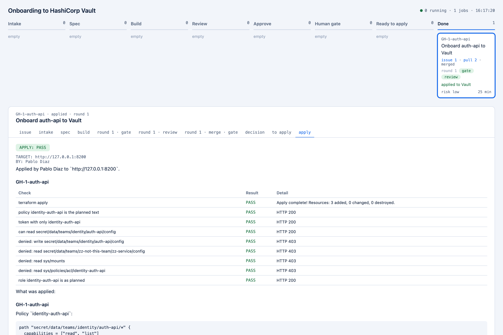
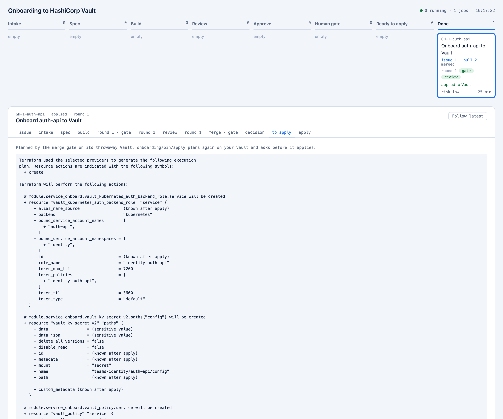

# vault-onboarding-line

Onboarding a service to Vault is always the same small change: a policy, a Kubernetes auth role and a few secret paths. It's boring work, and boring work gets approved without anyone really reading it. That's fine until one of those policies gives a service access to another team's secrets.

I wanted to see how far I could automate this with Claude Code without losing control of it. You open a GitHub issue asking for an onboarding and you get back a merged pull request with the spec, the plan and the Terraform. Nobody approves the steps in between. Then it stops and tells you: this is everything we created, if you are happy, apply it.

So the agents do the writing, scripts do the checking, and a person is still the one who changes Vault.



## How it works

1. You file an issue with the "Onboard a service to Vault" form. The form adds the `onboard` label.
2. Intake reads the issue. If a value is missing it asks on the issue and waits. If the request asks for something it shouldn't, like another team's secret paths, it rejects it and says why.
3. The spec-writer turns the issue into a spec with requirements R1 to R5.
4. The builder writes the plan and the Terraform from the spec and opens a draft pull request. It never reads the issue, only the spec.
5. The gate runs. The gate is a script, not an agent. If it fails, the builder gets the report and tries again.
6. A reviewer checks the pull request against the issue and the spec. It runs on a different model than the builder.
7. An approver decides whether to merge or to hand the pull request to a person.
8. The merge script runs the gate one more time and merges.
9. You run `onboarding/bin/apply <issue>`. It shows you what will change in Vault and asks before it does anything.

A job gets three rounds of build, gate and review. If it's still not right after the third, it goes to a person.

## The gate

If nobody approves each step, something else has to catch a bad policy. That's the job of `onboarding/bin/gate`.

I'm strict about it because of what I found in the previous version of this project, [sdd-tf-vault](https://github.com/pablogd-hashi/sdd-tf-vault). It had a validation step, a person approved every phase, and when I went back to look, the policy checks had never run at all. The script treated a skipped check as a pass. So this gate has no skips. If a tool is missing or a check can't run, it fails.

This is what it does:

- It checks that the branch only adds one new folder under `requests/` and touches nothing else.
- It checks that `main.tf` is the template with the five values filled in. This happens before Terraform gets near the file.
- It checks that no other request already onboards the same service.
- It runs `terraform plan` and then Conftest on the plan, which looks at every path and capability in the policy.
- It starts a throwaway Vault, applies the request there and logs in with a token that has only the new policy. That token must be able to read its own secrets, and it must get `permission denied` when it tries to write, delete, read another team's secrets or touch `sys/`.

That last check is the one I trust most. A plan can look fine and still grant more than you meant, and asking a real Vault takes about ten seconds.

The gate always runs from `main`, never from the branch it is checking, so a branch can't change its own rules.

You can try it on the example request:

```bash
onboarding/bin/gate --request PE-001-payments-api
```

## Applying

After the merge nothing is in Vault yet. You apply it yourself:

```bash
onboarding/bin/apply 12
```

The script shows you the policy, the role and the Terraform plan, and waits for you to type `yes`. It then applies exactly the plan it showed you, checks the result on the Vault the same way the gate does, and closes the issue.

Agents can't run this step. The script needs a real terminal, a hook blocks the command inside Claude Code, and it only talks to a Vault on 127.0.0.1. For a shared Vault I would move this step to a pipeline with an approval and a short-lived token. There is an example in [docs/examples/apply-shared-vault.yml](docs/examples/apply-shared-vault.yml), but I haven't run it.

## Run it

You need `git`, `gh` (logged in), `terraform`, `vault`, `conftest`, `python3` 3.9 or newer and Claude Code. No Docker, no framework, no build step.

The full guide is [docs/run.md](docs/run.md). It goes from installing the tools to an applied request and has five examples to try. The short version:

Create the labels, once per repository:

```bash
onboarding/bin/labels
```

Start the board at http://127.0.0.1:8765:

```bash
python3 onboarding/board/serve.py
```

File an issue with the form, then open Claude Code in this repository:

| Command | What it does |
|---|---|
| `/onboard run` | Runs every open `onboard` issue, three at a time. Also picks up unfinished jobs. |
| `/onboard run 12` | Runs issue 12 only. |
| `/onboard where is 12?` | Tells you where the job is. |
| `/onboard for 12: use namespace identity-prod` | Sends your feedback to the builder, when a job is waiting for you. |
| `/onboard onboard search-api for team discovery ...` | Files the issue for you. |

## Following a job

You don't need to keep Claude Code in front of you to know what's going on.

On GitHub, the issue has one label that tells you the stage: `onboard:intake`, `onboard:spec`, `onboard:build`, `onboard:review`, `onboard:approve`, `onboard:ready-to-apply`. The labels `onboard:needs-info` and `onboard:needs-human` mean it's waiting for someone. Every step also leaves a comment, on the issue or on the pull request.

The board is one HTML page and a small Python server. Each job is a card that moves from lane to lane, and the panel below shows what each step produced. When a job is ready to apply, the panel shows the Terraform plan, so you can read it before you run the apply script.



## What is in the repo

```
requests/<id>/                 the spec, plan and Terraform for one service
requests/_template/            the shape they have to follow
terraform/modules/vault-service-onboard/   the only module a request can call
terraform/platform/            the Kubernetes auth mount
policies/conftest/             the policy rules and their tests
onboarding/bin/                job, gate, merge, apply, labels
onboarding/board/              the board
.claude/                       the agents, the /onboard skill, the hook
docs/                          run guide, architecture, decision record
```

There are five agents, one per role. Each one reads some files, writes one file and answers with one line.

| Agent | Reads | Writes | Shell |
|---|---|---|---|
| `intake` | the issue | `intake.md`: accepted, needs-info or rejected | no |
| `spec-writer` | the issue and intake's answer | `01-spec/spec.md` | no |
| `builder` | the spec, the last gate report and review | `02-plan/plan.md`, `03-terraform/main.tf`, the pull request | yes |
| `reviewer` | the spec, the plan, the diff, the gate report | `review.md`: PASS or CHANGES | read-only |
| `approver` | the whole job | `decision.md`: APPROVE or ESCALATE | read-only |

The scripts decide what happens next. `onboarding/bin/job` is the only thing that changes the state of a job, and it checks the file the agent wrote, not what the agent said. `gate` checks a branch, `merge` is the only thing that merges, and `apply` is the step you run yourself.

## The rules

The rules for the agents are in [CLAUDE.md](CLAUDE.md): never invent a value, only use the module, least privilege, one request per service. But telling a model "don't merge" is not enough for me, so the rules that a shell command could break are blocked by a hook, [.claude/hooks/guard.py](.claude/hooks/guard.py):

- no merge by an agent or a session
- no push outside `onboard/*`, and no force push
- no `terraform apply` or Vault write to anything but 127.0.0.1
- no agent edits to the gate, the policies, the module or the hook
- no apply by an agent or a session

The hook matches the text of the command, so it stops mistakes. It won't stop someone who is really trying. What doesn't depend on matching text is the gate running from `main`.

## What it doesn't do

It handles one kind of request. If an onboarding needs a change to the module, the platform layer or the policies, intake rejects it and a person does that work. It doesn't fix merge conflicts, it escalates them. And so far it has only applied to a local Vault.

## More

- [docs/run.md](docs/run.md): how to run it, step by step
- [docs/architecture.md](docs/architecture.md): how it's built and why
- [docs/adr/001-autonomous-onboarding-line.md](docs/adr/001-autonomous-onboarding-line.md): the decision record

## Credit and licence

The idea comes from zazencodes' [software-factory-claude-code-v2](https://github.com/zazencodes/zazencodes-season-3/tree/main/src/software-factory-claude-code-v2): one skill that orchestrates, one agent per role, a script that owns the state, and a gate that runs from the main checkout. I took the idea and none of the code. This repository is MIT licensed.
