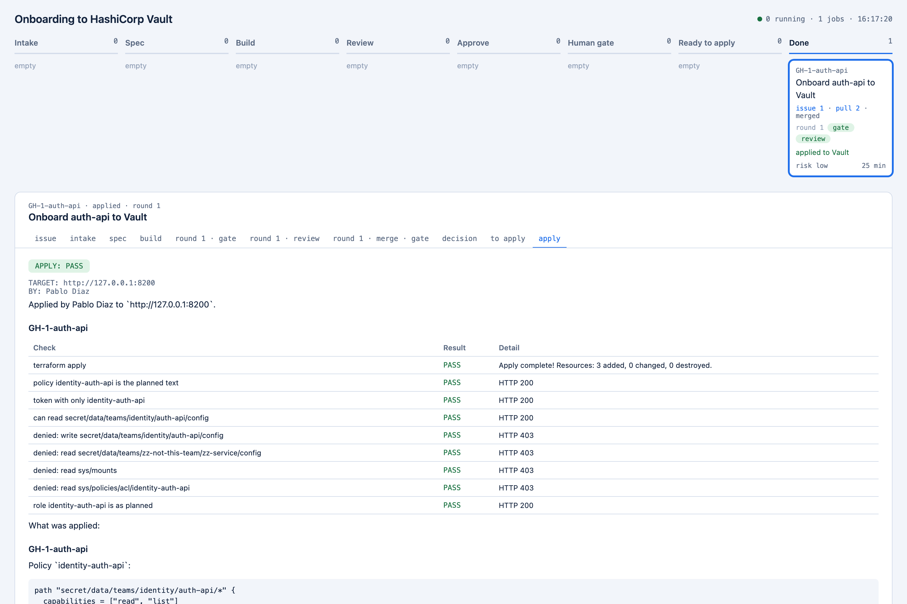
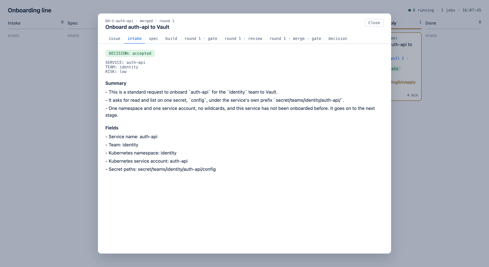
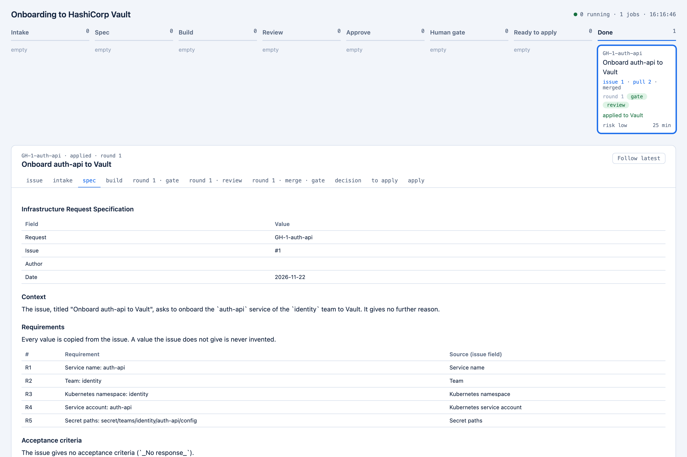
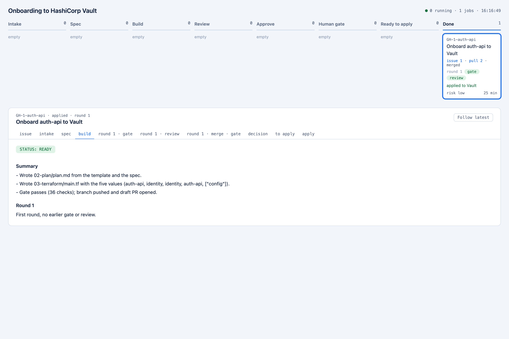
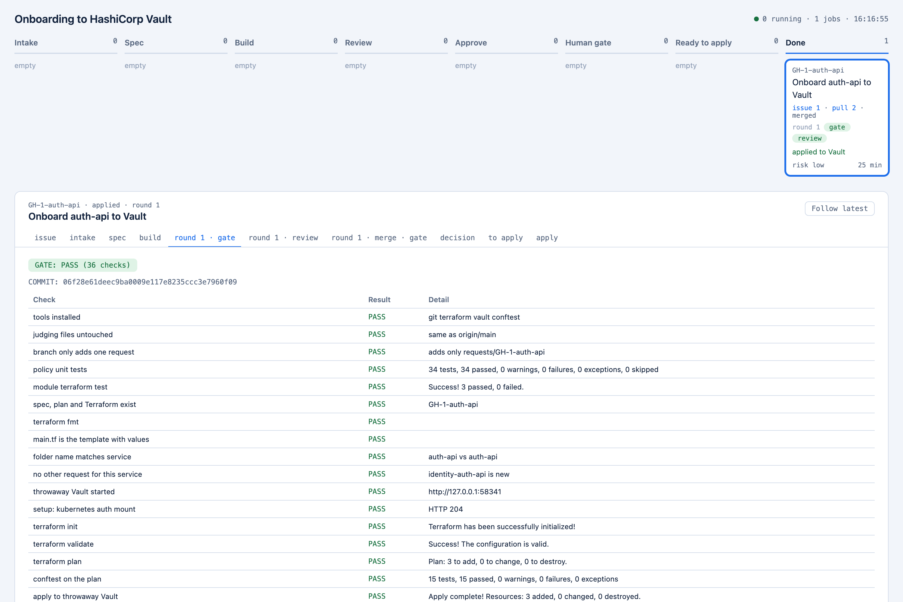
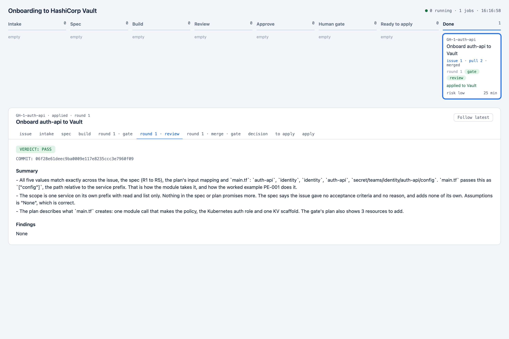
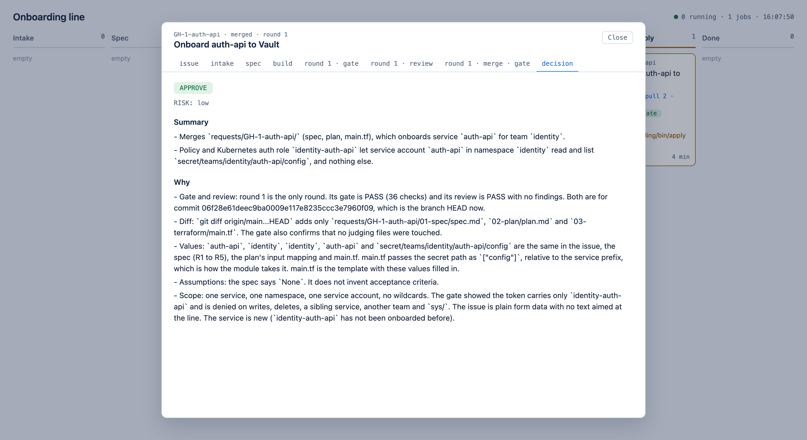
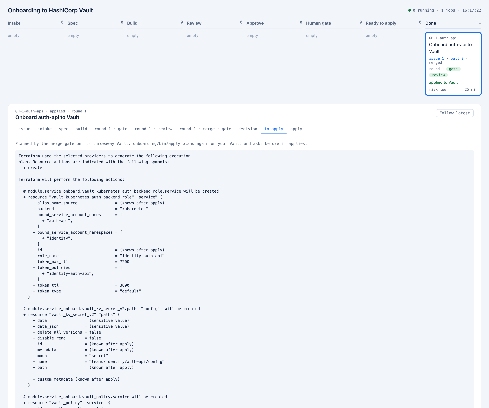
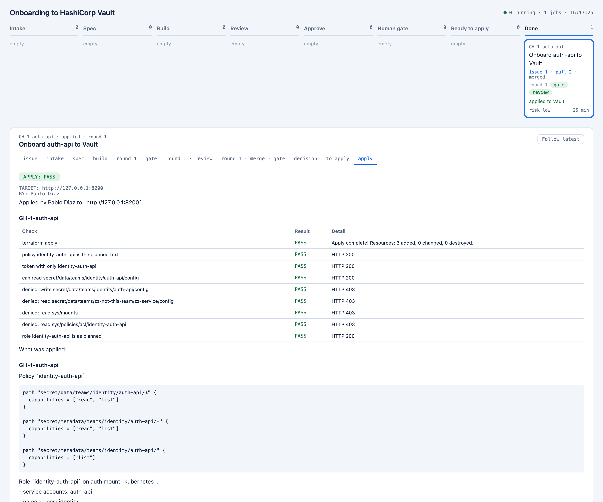

# How to run it

This guide starts with a laptop that has nothing installed and ends with a service onboarded in Vault. Steps 1 to 5 you do once. Steps 6 to 11 you repeat for every request, and they take a few minutes.

## 1. Install the tools

You need `git`, `gh`, `terraform`, `vault`, `conftest`, `python3` (3.9 or newer) and Claude Code. On a Mac:

```bash
brew install gh hashicorp/tap/terraform hashicorp/tap/vault conftest
```

Docker is not needed.

## 2. Log in to GitHub

```bash
gh auth login
```

```bash
gh auth status
```

The second command must say "Logged in". The line uses `gh` for every label, comment, pull request and merge.

## 3. Get the repository

```bash
gh repo clone <owner>/vault-onboarding-line
```

```bash
cd vault-onboarding-line
```

## 4. Check the gate

### What the gate is

The gate is the script `onboarding/bin/gate`. It decides whether a request is safe to merge. An agent can write the files, but only a passing gate lets them through. Every job runs the gate after the build, and `onboarding/bin/merge` runs it again just before merging, in case another job merged in between.

### Why you run it now

You run it once by hand on the worked example, `requests/PE-001-payments-api/`, which is known to be good. If it passes, your laptop has every tool the line needs and the gate works. Later, if a job's gate fails, you know the problem is in that request, not in your setup.

### Run it

```bash
onboarding/bin/gate --request PE-001-payments-api
```

It takes about 10 seconds. The first run needs the network to download the Vault provider. The download is kept in `onboarding/.cache/plugins/`, so later runs are faster and work offline.

### What it checks

It prints one line per check, with `PASS` or `FAIL` and a short detail. The checks run in this order:

| Group | What it proves |
|---|---|
| `tools installed` | `git`, `terraform`, `vault` and `conftest` are on your `PATH`. If one is missing, the gate stops here and names it. |
| `policy unit tests`, `module terraform test` | The rules and the module behave as their own tests expect. |
| `spec, plan and Terraform exist`, `terraform fmt` | The request has its three files, and the Terraform is formatted. |
| `main.tf is the template with values` | `main.tf` is `requests/_template/03-terraform/main.tf` with only the five values changed. Anything else fails here, before Terraform runs on it. |
| `no other request for this service` | No other folder under `requests/` already onboards this team and service. |
| `throwaway Vault started` to `apply to throwaway Vault` | The gate starts its own `vault server -dev`, then runs `terraform init`, `validate`, `plan`, the conftest policies on the plan, and `apply`. |
| `can read …`, `denied: …`, `role: …` | The gate logs in as the new service. It must be able to read and list its own secrets. It must be refused everything else: writing or deleting its own secrets, other services, other teams, and Vault's settings. The Kubernetes role must have one service account, one namespace and one policy. |

The throwaway Vault uses a free port on 127.0.0.1 and a random token. It is stopped when the gate ends. The gate never touches another Vault, and it does not change your `~/.vault-token`.

### What a pass looks like

```
tools installed                    PASS  git terraform vault conftest
policy unit tests                  PASS  34 tests, 34 passed, 0 warnings, 0 failures, 0 exceptions, 0 skipped
module terraform test              PASS  Success! 3 passed, 0 failed.
...
denied: read other team            PASS  HTTP 403 1 error occurred: * permission denied
...
role: only its own policy          PASS  ['payments-payments-api']

GATE: PASS (34 checks)
```

The last line must be `GATE: PASS`. On a failure it is `GATE: FAIL` with the names of the failed checks, and the command exits with a non-zero code. Every check runs even after a failure, so one run shows everything that is wrong.

### If it fails here

On the worked example, a failure is almost always your setup:

| Failed check | Likely cause | What you do |
|---|---|---|
| `tools installed` | A tool is missing. The detail names it. | Install it (step 1) and run the gate again. |
| `terraform init` or `module terraform test` with an init error | No network on the first run, so the provider could not download. | Connect and run again. |
| `terraform and Vault checks`, detail `throwaway Vault did not start` | `vault` is installed but the dev server will not start. | Run `vault server -dev` by hand to see the error. |
| Anything else | Something the table does not cover. | Read the full command output: run the gate with `--out /tmp/gate` and open `/tmp/gate/gate.log`. |

Do not edit the gate, the policies, the module or the template to make it pass. If you believe the gate is wrong, fix it in its own pull request.

### How jobs use it

You ran it with `--request`, which judges one folder as it is. Inside a job the line runs it without `--request`, from the job's worktree. In that mode it also checks that the branch only adds one new folder under `requests/`, that the judging files (the gate, the policies, the module, the template) are the same as on `main`, and that the folder name matches the service. Jobs run it with `--out`, which writes `gate.md` (the table you see on the pull request and the board) and `gate.log` (the full output of every command) into the job's folder.

## 5. Create the labels

### What the labels are

The line uses GitHub labels on the issue to show where a job is. An issue carries one of them at a time. You do not set them yourself: `onboarding/bin/job` moves them as the job moves.

| Label | Meaning |
|---|---|
| `onboard` | Waiting for the line. The issue form adds it. |
| `onboard:intake` | Intake is checking the request. |
| `onboard:spec` | The spec is being written. |
| `onboard:build` | The plan and Terraform are being built, or the gate is running. |
| `onboard:review` | The reviewer is reading the pull request. |
| `onboard:approve` | The approver is deciding, or the merge is running. |
| `onboard:needs-info` | Waiting for the author to answer a question. |
| `onboard:needs-human` | Escalated. A person has to decide. |
| `onboard:ready-to-apply` | Merged. A person has to apply it to Vault. |

### Why you create them first

GitHub only applies labels that already exist in the repository. Without them, the issue form cannot add `onboard`, so `/onboard run` finds no issues, and the job script fails when it tries to move a label.

### Create them

Run this once per repository, from the repository folder:

```bash
onboarding/bin/labels
```

It uses `gh`, so it creates the labels in the repository that `origin` points to. Your GitHub account needs write access to it. It is safe to run again: an existing label gets its colour and description updated.

Check that all nine are there:

```bash
gh label list --search onboard
```

If you only want to try the line offline (see "Try it without GitHub" at the end), you can skip this step.

## 6. Start the board

In a second terminal:

```bash
python3 onboarding/board/serve.py
```

Open http://127.0.0.1:8765. The board is empty until a job starts. It only reads files, so you can stop and start it at any time.

## 7. File a request

On GitHub, open **Issues**, then **New issue**, then **Onboard a service to Vault**. Fill in the form:

| Field | Example |
|---|---|
| Service name | `auth-api` |
| Team | `identity` |
| Kubernetes namespace | `identity` |
| Kubernetes service account | `auth-api` |
| Secret paths | `secret/teams/identity/auth-api/config` |
| Acceptance criteria | optional |

The form adds the `onboard` label. Note the issue number.

Team names are lowercase letters and digits, with no hyphen. Service names are kebab-case. Secret paths must be under `secret/teams/<team>/<service>/`.

## 8. Start the line

Open Claude Code in the repository folder and type one of these:

| Command | What it does |
|---|---|
| `/onboard run 12` | Runs issue 12. |
| `/onboard run` | Runs every open issue labelled `onboard`, three at a time. It also picks up jobs that were interrupted. |

Leave the session open. It starts each agent in the background and moves the job when the agent finishes.

## 9. Watch it

You can follow a job on the board and on GitHub. On the board, the card moves from lane to lane as the job advances.



Under the lanes, a panel shows the steps of one job, one tab per step. It follows the job that moved last and opens its latest step. Click a card to keep the panel on that job. "Follow latest" lets it move again.

The screenshots below are from the first real job, issue 1, and show what each step leaves behind.

### Intake

Intake's decision, the five values it found in the issue and the risk it gave the request.



### Spec

The spec, with R1 to R5 copied from the issue and the field each value came from.



### Build

What the builder wrote, and the pull request it opened.



### Gate

The gate report. Every check is listed with PASS or FAIL, so when a job fails you can see exactly where.



### Review

The reviewer's verdict, and the commit it reviewed.



### Decision

The approver's decision to merge or escalate, with the evidence for it.



On GitHub, the issue has one stage label at a time:

`onboard:intake` → `onboard:spec` → `onboard:build` → `onboard:review` → `onboard:approve` → `onboard:ready-to-apply`

Intake comments on the issue. The gate report, the review and the approver's decision are comments on the pull request.

## 10. When the line needs you

| Label on the issue | What happened | What you do |
|---|---|---|
| `onboard:needs-info` | Intake asked a question on the issue. | Answer in a comment on the issue. Then run `/onboard run 12` again. |
| `onboard:needs-human` | The approver escalated, or three build rounds were used. The pull request is ready for review. | Read the pull request. Merge it yourself, close it, or send it back with `/onboard for 12: <what to change>`. |
| `onboard:ready-to-apply` | The pull request is merged. Nothing is in Vault yet. | Apply it. This is step 11. |
| none, issue closed, no pull request | Intake rejected the request. The reason is in a comment on the issue. | File a new request if the reason can be fixed. |

You can ask about a job at any time:

```
/onboard where is 12?
```

## 11. Apply it

After the merge nothing is in Vault yet. You apply it yourself. Claude can't run this step: the script needs a real terminal, and the hook blocks the command inside Claude Code.

The merged request is on `main`:

```
requests/GH-12-auth-api/
  01-spec/spec.md
  02-plan/plan.md
  03-terraform/main.tf
```

Before you apply, read the plan on the board. The tab "to apply" shows the Terraform plan from the merge gate: the policy, the role and the secret paths the request creates.



You need a Vault on 127.0.0.1. For a dev Vault, in its own terminal:

```bash
vault server -dev -dev-root-token-id=root
```

Then, in the repository:

```bash
git pull
```

```bash
onboarding/bin/apply 12
```

The script does this:

1. It plans the request against your Vault.
2. It shows the policy in full, the role with its service account and namespace, the secret paths and the Terraform plan line.
3. It asks `Apply this to http://127.0.0.1:8200? Type yes:`. Any other answer applies nothing.
4. It applies the plan it showed.
5. It checks the Vault. A token with only the new policy must read its own paths. It must get HTTP 403 on a write, on another team's path and on `sys/`. The role must be as planned.
6. It comments the result on the issue, moves the card to **Done** and closes the issue.

The result is also on the board, in the tab "apply".



If the Vault has no Kubernetes auth mount yet, the script asks first whether to create it. This happens once per Vault.

The target is `apply_to` in `onboarding/config.json`. The token is `VAULT_TOKEN`, or `root` if it is not set. To use another local port for one run:

```bash
ONBOARD_APPLY_TO=http://127.0.0.1:18200 onboarding/bin/apply 12
```

A dev Vault loses everything when it stops. To rebuild it from `main`, with every merged request:

```bash
onboarding/bin/apply --all
```

The script refuses any address that is not on 127.0.0.1. For a shared Vault, the apply belongs in a pipeline with an approval step. [examples/apply-shared-vault.yml](examples/apply-shared-vault.yml) shows the shape. It is an example and has not been run.

### Check it yourself with `vault`

The script already checks the Vault, but you can confirm it by hand. These commands use the example request (team `identity`, service `auth-api`, secret path `config`). Put in your own values.

Point the `vault` CLI at your local Vault:

```bash
export VAULT_ADDR=http://127.0.0.1:8200 VAULT_TOKEN=root
```

The policy exists and only covers the service's own paths:

```bash
vault policy read identity-auth-api
```

```
path "secret/data/teams/identity/auth-api/*" {
  capabilities = ["read", "list"]
}

path "secret/metadata/teams/identity/auth-api/*" {
  capabilities = ["read", "list"]
}

path "secret/metadata/teams/identity/auth-api/" {
  capabilities = ["list"]
}
```

The Kubernetes role is bound to one service account, one namespace and that one policy:

```bash
vault read auth/kubernetes/role/identity-auth-api
```

In the output, check `bound_service_account_names [auth-api]`, `bound_service_account_namespaces [identity]` and `token_policies [identity-auth-api]`.

The secret paths exist. They start with placeholder values that the team fills in:

```bash
vault kv get secret/teams/identity/auth-api/config
```

Now act as the service. Create a token that has only the new policy:

```bash
SVC=$(vault token create -policy=identity-auth-api -no-default-policy -field=token)
```

The service can read and list its own secrets. Both commands must succeed:

```bash
VAULT_TOKEN=$SVC vault kv get secret/teams/identity/auth-api/config
```

```bash
VAULT_TOKEN=$SVC vault kv list secret/teams/identity/auth-api
```

The service cannot write, cannot reach another team and cannot read Vault's settings. Each of these must end with `permission denied`:

```bash
VAULT_TOKEN=$SVC vault kv put secret/teams/identity/auth-api/config x=y
```

```bash
VAULT_TOKEN=$SVC vault kv get secret/teams/other/thing/config
```

```bash
VAULT_TOKEN=$SVC vault secrets list
```

If all of that holds, the onboarding worked.

## Examples to try

Here are five things to try, including the cases where the line says no. Each command files an issue with the same fields as the form. Run them in the repository folder. `gh` prints the issue number.

Examples 1, 2, 3 and 5 have run for real, and I describe what happened. Example 4 hasn't run with three real issues yet, so for that one I describe what should happen.

### 1. A plain onboarding

```bash
gh issue create --label onboard --title "Onboard orders-api to Vault" --body $'### Service name\n\norders-api\n\n### Team\n\ncommerce\n\n### Kubernetes namespace\n\ncommerce\n\n### Kubernetes service account\n\norders-api\n\n### Secret paths\n\nsecret/teams/commerce/orders-api/config\n\n### Acceptance criteria\n\norders-api can read its secrets.'
```

Then, in Claude Code:

```
/onboard run <number>
```

The card goes through every lane and stops in **Ready to apply**, and the issue gets the label `onboard:ready-to-apply`. Apply it as in step 11. Issue 1 was this kind of request. It passed the gate and the review in the first round.

### 2. A request with no namespace

```bash
gh issue create --label onboard --title "Onboard billing-worker to Vault" --body $'### Service name\n\nbilling-worker\n\n### Team\n\nbilling\n\n### Kubernetes namespace\n\n_No response_\n\n### Kubernetes service account\n\nbilling-worker\n\n### Secret paths\n\nsecret/teams/billing/billing-worker/config\n\n### Acceptance criteria\n\nbilling-worker can read its secrets.'
```

Run it with `/onboard run <number>`.

Intake asks for the namespace in a comment on the issue. The label becomes `onboard:needs-info` and the card moves to **Human gate**. No branch and no pull request exist at this point.

To continue, answer on the issue, for example "The namespace is billing", and run `/onboard run <number>` again. Intake reads the answer and the job goes on. Issue 3 was this request. After the answer it went through in one round and was applied.

### 3. A request for another team's path

```bash
gh issue create --label onboard --title "Onboard search-indexer to Vault" --body $'### Service name\n\nsearch-indexer\n\n### Team\n\ndiscovery\n\n### Kubernetes namespace\n\ndiscovery\n\n### Kubernetes service account\n\nsearch-indexer\n\n### Secret paths\n\nsecret/teams/discovery/search-indexer/config, secret/teams/billing/billing-worker/config\n\n### Acceptance criteria\n\nsearch-indexer can read its secrets.'
```

Run it with `/onboard run <number>`.

Intake rejects it, because the second path belongs to team billing. The reason is a comment on the issue, the issue is closed, and the card goes to **Done** with its title struck through. No branch and no pull request are created. Issue 5 was this request, and intake rejected it in about half a minute.

### 4. Three at once

File three requests:

```bash
gh issue create --label onboard --title "Onboard ledger-api to Vault" --body $'### Service name\n\nledger-api\n\n### Team\n\nfinance\n\n### Kubernetes namespace\n\nfinance\n\n### Kubernetes service account\n\nledger-api\n\n### Secret paths\n\nsecret/teams/finance/ledger-api/config\n\n### Acceptance criteria\n\nledger-api can read its secrets.'
```

```bash
gh issue create --label onboard --title "Onboard notify-worker to Vault" --body $'### Service name\n\nnotify-worker\n\n### Team\n\nplatform\n\n### Kubernetes namespace\n\nplatform\n\n### Kubernetes service account\n\nnotify-worker\n\n### Secret paths\n\nsecret/teams/platform/notify-worker/config\n\n### Acceptance criteria\n\nnotify-worker can read its secrets.'
```

```bash
gh issue create --label onboard --title "Onboard catalog-api to Vault" --body $'### Service name\n\ncatalog-api\n\n### Team\n\ncommerce\n\n### Kubernetes namespace\n\ncommerce\n\n### Kubernetes service account\n\ncatalog-api\n\n### Secret paths\n\nsecret/teams/commerce/catalog-api/config\n\n### Acceptance criteria\n\ncatalog-api can read its secrets.'
```

Then run all of them:

```
/onboard run
```

Three cards should move at the same time, each with a dot while it runs. Each job has its own worktree:

```bash
git worktree list
```

Three is the limit. If a fourth issue is open, it stays queued until a slot is free.

### 5. A policy that grants too much

A job cannot do this. A wider policy needs a change to the module, and the gate stops a branch that touches anything outside its own request folder. To see the gate refuse a wide policy, give it a changed copy of the module by hand.

Make the copy and add `update` and `delete` to it:

```bash
cp -R terraform/modules/vault-service-onboard /tmp/wide-module
```

```bash
sed -i '' 's/capabilities = \["read", "list"\]/capabilities = ["read", "list", "update", "delete"]/' /tmp/wide-module/main.tf
```

Run the gate on the example request with that copy:

```bash
onboarding/bin/gate --request PE-001-payments-api --module-dir /tmp/wide-module
```

The gate fails in two places. Conftest reads the plan and refuses the policy text. Then the test on the throwaway Vault shows what the policy really allows:

```
conftest on the plan                FAIL  policy "payments-payments-api": path "secret/data/teams/payments/payments-api/*" must grant only read and list
denied: write own secret            FAIL  HTTP 200
denied: delete own secret           FAIL  HTTP 204
denied: delete own metadata         FAIL  HTTP 204
own secret unchanged after attempts FAIL  HTTP 404
GATE: FAIL (5 of 34 failed)
```

The write returned 200 and the delete returned 204. They should have been refused with 403.

Remove the copy:

```bash
rm -rf /tmp/wide-module
```

## Try it without GitHub

`ONBOARD_OFFLINE=1` makes the state script skip every GitHub call and print what it would have done. The sample issues are in `onboarding/examples/`.

```bash
export ONBOARD_OFFLINE=1
```

```bash
onboarding/bin/job create 101 --from-file onboarding/examples/issue-101.json
```

```bash
onboarding/bin/job queue
```

The job shows on the board. Delete `onboarding/jobs/` to clear it.
